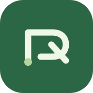
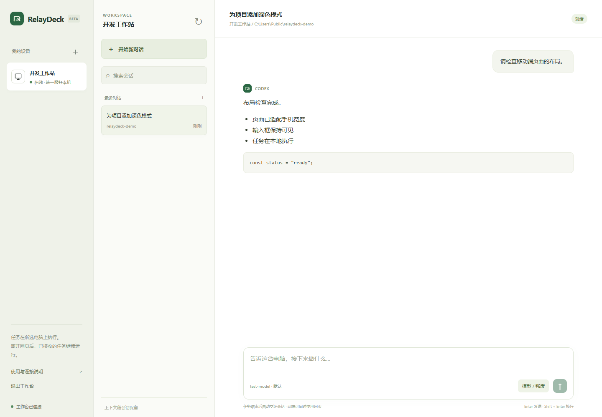
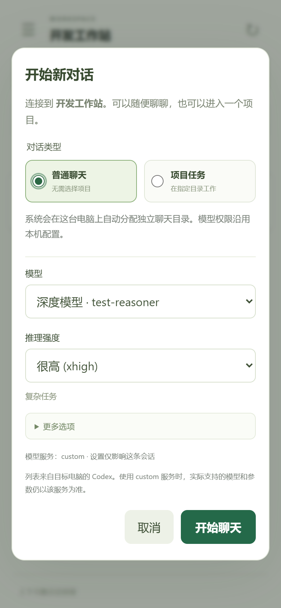
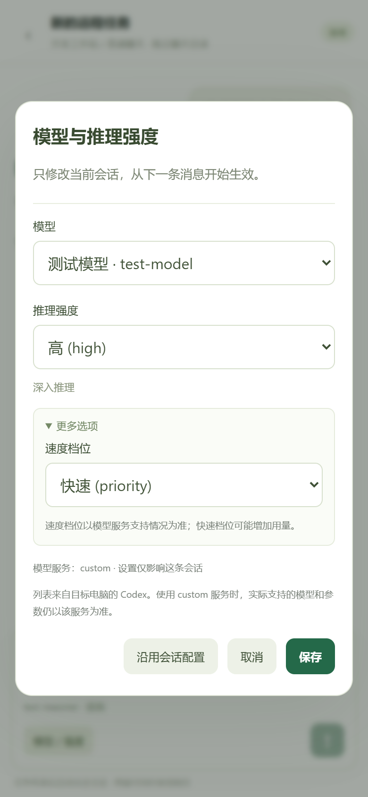
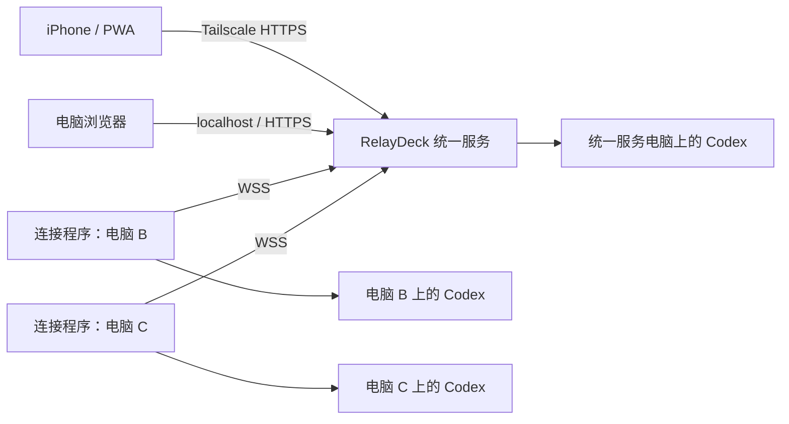

<p align="center">
  
</p>

<h1 align="center">RelayDeck</h1>

<p align="center">
  用 iPhone 或浏览器查看多台电脑上的 Codex 会话，继续对话，并让任务在对应电脑上执行。
</p>

<p align="center">
  <strong>私有网络访问</strong> · <strong>多电脑</strong> · <strong>PWA</strong> · <strong>custom provider</strong> · <strong>本地执行</strong>
</p>

RelayDeck 把一台常开电脑作为统一服务。手机通过 **Tailscale Serve + HTTPS** 打开工作台，其他电脑运行轻量连接程序接入。无需购买域名或云服务器，Codex 凭据、项目文件和任务执行仍留在各自电脑上。

当前版本：**0.2.1**

## 界面预览



<table>
  <tr>
    <td width="50%" align="center"><strong>普通聊天与项目任务</strong></td>
    <td width="50%" align="center"><strong>模型、推理强度与速度</strong></td>
  </tr>
  <tr>
    <td></td>
    <td></td>
  </tr>
</table>

> 截图由自动化测试环境生成，使用虚构设备名、示例目录、测试模型和模拟会话，不包含真实访问码、Tailscale 域名、用户名或项目内容。

## 可以做什么

- 在手机和电脑浏览器中查看、搜索和继续 Codex 会话。
- 管理多台执行电脑，查看在线状态并切换设备。
- 新建无需项目路径的普通聊天，或指定目录创建项目任务。
- 按会话选择模型、推理强度和速度档位，支持手动填写 custom 模型 ID。
- 每台电脑记住网页上一次选择的模型及匹配参数。
- 实时展示 Markdown、思考摘要、终端输出、文件变更和工具状态。
- 在手机处理命令、文件、权限审批和 Codex 提问。
- 页面断线后重新读取历史、运行状态和待处理审批。
- 电脑与手机同时查看同一会话，并轮流发送消息。
- 每轮任务结束后自动释放 Codex 会话写入锁，便于切回原生客户端。
- 通过提交标识和持久化记录避免网络重试造成重复执行。

## 工作方式



统一服务只负责网页、身份验证、状态同步和设备路由。每台执行电脑继续使用自己的 Codex provider、登录信息、模型、MCP、权限设置、项目文件和历史会话。

## 运行要求

- Windows，以及 Node.js **22.13 或更新版本**。
- 本机能够运行 `codex app-server`。
- 当前 Windows 用户的 Codex 已配置并能正常使用。
- 统一服务电脑、执行电脑和手机加入同一个 Tailscale 网络。
- 统一服务电脑保持开机、联网，并避免自动睡眠。

当前协议已在 `codex-cli 0.169.0-alpha.11.1` 上验证，也支持读取 custom provider 会话。

## 快速开始

### 1. 安装依赖

在统一服务电脑打开 PowerShell，进入项目目录：

```powershell
cd C:\path\to\relaydeck
npm.cmd ci --omit=dev
npm.cmd run doctor
```

开发或运行浏览器测试时使用完整依赖：

```powershell
npm.cmd ci
```

如果 `npm ci` 被 `Ctrl+C` 中断，请重新执行。该命令会先重建 `node_modules`，中途退出会留下不完整的依赖目录。

### 2. 启动统一服务

后台运行：

```powershell
powershell -ExecutionPolicy Bypass -File .\Start-RelayDeck.ps1
```

前台运行：

```powershell
npm.cmd start
```

本机打开：

```text
http://localhost:3030
```

查看浏览器访问码：

```powershell
npm.cmd run access
```

停止后台服务：

```powershell
powershell -ExecutionPolicy Bypass -File .\Stop-RelayDeck.ps1
```

第一次启动会生成 `.relaydeck/config.json`。该目录包含访问码、浏览器会话和设备凭据，已在 `.gitignore` 中排除。

### 3. 开启 Tailscale HTTPS

```powershell
powershell -ExecutionPolicy Bypass -File .\Enable-Tailscale.ps1
```

脚本将 `http://127.0.0.1:3030` 映射到当前 Tailnet 内的私有 HTTPS 地址。它使用 **Tailscale Serve**，不会开启公网 Funnel。

如果终端给出 Tailscale 授权页面，按提示启用 Serve 后再次运行脚本。最终会显示类似：

```text
https://你的电脑.你的网络.ts.net
```

### 4. 在 iPhone 上使用

1. 安装 Tailscale，登录与电脑相同的 Tailnet，并保持连接。
2. 用 Safari 打开统一服务的 Tailscale HTTPS 地址。
3. 输入 `npm.cmd run access` 显示的访问码。
4. 选择电脑和会话，或点击“开始新对话”。
5. Safari 中选择“分享 → 添加到主屏幕”，即可作为 PWA 使用。

手机锁屏或网页断线不会取消电脑已经接收的任务。重新打开页面后，RelayDeck 会读取最新状态。离线状态下不会提交新任务。

## 普通聊天、项目与模型

**普通聊天**无需填写项目路径。RelayDeck 会在目标电脑的 `.relaydeck/chats/` 下分配独立目录。它仍沿用目标电脑的 Codex 工具和权限配置。

**项目任务**需要填写目标电脑上已经存在的绝对目录。最近使用的项目会出现在新建窗口中。

模型设置可以在新建对话时选择，也可以通过输入框下方的“模型 / 强度”修改：

- 设置从下一条消息开始生效。
- 模型列表和可用强度来自目标电脑的 Codex。
- custom 服务可手动输入模型 ID，实际支持情况由上游服务决定。
- 快速速度档位可能增加用量。
- 每台电脑分别记住上次在网页中选择的模型、强度和速度。
- 设置只影响当前会话，不修改全局 Codex 配置。

## 接入第二台电脑

第二台电脑只运行连接程序，不需要再启动统一服务，也不需要配置 Tailscale Serve。

1. 把仓库克隆或解压到第二台电脑。
2. 确认该电脑自己的 Node.js、Codex 和 Tailscale 可以使用。
3. 安装运行依赖：

   ```powershell
   cd C:\path\to\relaydeck
   npm.cmd ci --omit=dev
   npm.cmd run doctor
   ```

4. 在网页“我的设备”旁点击 `＋`，或在统一服务电脑执行：

   ```powershell
   npm.cmd run pair
   ```

5. 在第二台电脑执行生成的命令：

   ```powershell
   npm.cmd run agent -- --hub https://你的统一服务电脑.ts.net --code 一次性配对码 --name "我的笔记本"
   ```

配对码有效期为 10 分钟且只能使用一次。配对后，凭据保存在第二台电脑自己的 `.relaydeck/agent.json`。以后启动只需：

```powershell
npm.cmd run agent
```

连接程序需要保持运行。统一服务短暂离线时它会自动重连，已开始的本地任务继续执行。

## 与原生 Codex 客户端配合

RelayDeck 启动独立的 Codex App Server。原生客户端和 RelayDeck 进程不能同时持有同一会话的写入权。

- **RelayDeck → 原生客户端**：任务完成、失败或中断后，RelayDeck 自动退订并等待会话卸载。原生客户端必要时点击“重试”。
- **手动交还**：空闲会话可点击“交还桌面”。执行中或等待审批时不会强制释放。
- **原生客户端 → RelayDeck**：先在原生客户端关闭该会话并释放写入权，再从网页发送消息。
- 电脑和手机同时使用 RelayDeck 网页时共用一个执行连接，可以同步查看并轮流发送。

RelayDeck 不会强行抢占其他 Codex 进程持有的会话。

## 安全与隐私

- HTTP 服务默认只监听 `127.0.0.1`。
- 手机访问使用 Tailnet 内的 Tailscale Serve HTTPS。
- 浏览器登录使用访问码和 HttpOnly 会话 Cookie。
- 写请求检查来源，设备连接使用一次性配对码和独立凭据。
- `.relaydeck/`、`.dev/`、`node_modules/`、测试结果和源码压缩包均不会进入 Git。
- 模型 API Key 不会发送给手机或统一服务网页。
- 会话 API 响应不会进入 Service Worker 缓存。
- Markdown 输出经过清理后再渲染。
- 诊断命令只输出版本、网络和连通性信息。

公开仓库前不要手动添加 `.relaydeck`、日志、真实运行截图或包含个人目录的配置文件。

## 常见问题

| 现象 | 处理方法 |
| --- | --- |
| 手机打不开地址 | 检查手机与电脑的 Tailscale 连接、电脑睡眠状态和 `tailscale serve status` |
| 本机打不开 | 运行 `npm.cmd run doctor`，检查 `.relaydeck/hub.log` 和 `hub-error.log` |
| 登录失败 | 重新运行 `npm.cmd run access`；访问码不是 Tailscale 密码或模型 API Key |
| 设备离线 | 在对应电脑运行 `npm.cmd run agent` |
| 找不到 Codex | 安装 Codex CLI，或将 `CODEX_BIN` 指向可执行文件 |
| 项目目录不存在 | 路径必须存在于当前选择的执行电脑；普通聊天无需路径 |
| 原生客户端提示会话被占用 | 等待 RelayDeck 自动交还，或在空闲时点击“交还桌面” |
| 模型或强度被拒绝 | 检查 custom 服务支持的模型和参数，或清除当前会话覆盖 |
| `npm ci` 显示 `SIGINT` | 安装被中断，重新执行并等待命令完成 |

## 开发与验证

```powershell
npm.cmd ci
npm.cmd test
npm.cmd run test:browser
npm.cmd run doctor
```

测试覆盖登录、来源校验、Cookie、静态文件隔离、XSS 清理、会话历史、实时输出、审批、手机布局、PWA、双浏览器同步、多设备路由、模型设置、敏感配置过滤、会话写入锁和自动交还。

WebKit 验证：

```powershell
npx playwright install webkit
$env:BROWSER_ENGINE = 'webkit'
npm.cmd run test:browser
```

真实模型验收会产生模型使用量：

```powershell
node scripts/options-probe.js --execute
node scripts/smoke-codex.js --execute
```

## 项目结构

```text
src/
  main.js                  统一服务入口
  hub.js                   HTTP、登录、SSE、配对和设备路由
  codex.js                 Codex JSON-RPC 传输
  local-agent.js           会话、任务、审批和模型适配
  conversation-options.js  会话偏好与最近项目
  remote-agent.js          其他电脑的连接程序
public/                    手机网页与 PWA
scripts/                   诊断、配对、打包和验收脚本
test/                      协议、集成和浏览器测试
docs/images/               公开文档截图
```

## 参考

- [Codex App Server 协议](https://developers.openai.com/codex/app-server/)
- [Tailscale Serve](https://tailscale.com/docs/features/tailscale-serve)
